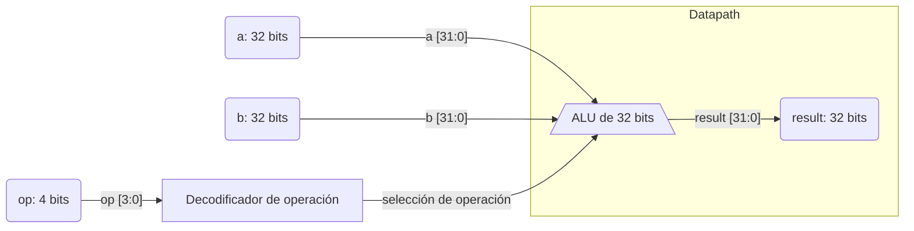

# ALU de 32 bits

ALU combinacional de 32 bits implementada en Verilog. El resultado depende
directamente de los operandos `a` y `b` y del selector `op`; no hay registros
ni señal de reloj.

## Arquitectura



### Datapath

El bloque ALU implementa suma, resta, operaciones bit a bit, desplazamientos
de un bit y comparación con signo. El resultado seleccionado se entrega por
`result`.

### Control

El campo `op` selecciona la operación. Los códigos no listados en la tabla
producen cero.

## Interfaz

| Puerto | Dirección | Ancho | Descripción |
|---|---|---:|---|
| `a` | Entrada | 32 bits | Primer operando |
| `b` | Entrada | 32 bits | Segundo operando |
| `op` | Entrada | 4 bits | Código de operación |
| `result` | Salida | 32 bits | Resultado de la operación |

El módulo no tiene parámetros, reloj, reset ni estado interno. `result` se
declara como `reg` porque se asigna dentro de un bloque `always`; esto no
implica almacenamiento, ya que el bloque es combinacional.

## Operaciones

| `op` | Operación | Resultado |
|---|---|---|
| `0000` | Suma | `a + b` |
| `0001` | Resta | `a - b` |
| `0010` | AND | `a & b` |
| `0011` | OR | `a | b` |
| `0100` | XOR | `a ^ b` |
| `0101` | NOT | `~a` |
| `0110` | Desplazamiento a la izquierda | `a << 1` |
| `0111` | Desplazamiento a la derecha | `a >> 1` |
| `1000` | Menor que con signo (SLT) | `1` si `$signed(a) < $signed(b)`; de lo contrario, `0` |
| Otros | Operación no definida | `0` |


## Archivos

| Archivo | Descripción |
|---|---|
| [`alu_v1.v`](./alu_v1.v) | RTL del módulo combinacional `alu_v1`. |
| [`tb.v`](./tb.v) | Testbench que aplica 100 vectores aleatorios, imprime resultados y genera `tb.vcd`. |
| [`synth_v1.ys`](./synth_v1.ys) | Script de Yosys para leer el RTL, verificar la jerarquía, sintetizar `alu_v1` y escribir `alu_v1.blif`. |
| `NangateOpenCellLibrary_typical.lib` | Biblioteca de celdas estándar incluida; su contenido no se documenta aquí. El script actual no la carga ni realiza mapeo tecnológico hacia ella. |

## Simulación y síntesis

Desde esta carpeta, la simulación puede ejecutarse con Icarus Verilog:

```sh
iverilog -o tb.vvp alu_v1.v tb.v
vvp tb.vvp
```

El testbench muestra los operandos, el selector y el resultado mediante
`$monitor`, y escribe la forma de onda en `tb.vcd`. Las entradas son aleatorias.

Primero, Yosys realiza la síntesis genérica y genera el netlist BLIF:

```sh
yosys -s synth_v1.ys
```

Después, `yosys-abc` carga la biblioteca Nangate, lee el BLIF, optimiza el
grafo lógico, realiza el mapeo tecnológico y reporta el retardo y la ruta:

```text
yosys-abc
read_lib NangateOpenCellLibrary_typical.lib
read_blif alu_v1.blif
strash
map
stime
print_delay
```

Ejecuta ambos pasos desde esta carpeta. El `.ys` genera `alu_v1.blif`; la
biblioteca `.lib` se carga por separado en ABC y no se modifica. No se asignaron
restricciones de temporización de ningún tipo: no hay período de reloj ni
retardos de entrada/salida. `stime` y `print_delay` reportan el retardo
estimado por ABC según la biblioteca cargada, no un análisis contra
restricciones de diseño.

## Métricas de síntesis reportadas

Resultados proporcionados para la ejecución ABC:

| Métrica | Valor |
|---|---:|
| Wire load | `none` |
| Gates | 601 (20.8 %) |
| Capacitancia | 3.6 ff (0.0 %) |
| Área | 596.64 (100.0 %) |
| Delay | 1001.73 ps (16.0 %) |

Estas cifras corresponden al flujo ABC descrito arriba para la ALU actual.
Los porcentajes se transcriben tal como fueron reportados. No se aplicaron
restricciones temporales.

## Análisis del camino crítico

Camino reportado: entrada primaria `b[1]` a salida primaria `result[31]`.
La tabla conserva las celdas, pines, tiempos de llegada y tiempos I/O del
reporte ABC. Los tiempos se expresan en picosegundos.

La larga cadena de celdas combinacionales sigue siendo consistente con una
dependencia de acarreo que atraviesa varios bits. El RTL actualizado usa
comparación con signo en SLT. El reporte de celdas por sí solo no permite
atribuir el camino a suma, resta o SLT: la lógica puede compartirse o
reestructurarse durante la síntesis y el mapeo. Para confirmarlo se requiere
aislar operaciones o comparar implementaciones alternativas.

Una experimentación posterior puede reemplazar la implementación del
acarreo por otra arquitectura de sumador y volver a ejecutar exactamente el
mismo flujo ABC. Para que la comparación sea válida, conserva la misma
biblioteca, los mismos comandos de mapeo y la ausencia de restricciones, y
compara tanto el retardo (`stime`) como el área y la cantidad de celdas.

| Nivel | Celda/pin | Tipo | Tiempos I/O (ps) | Llegada (ps) |
|---:|---|---|---|---:|
| 0 | Entrada primaria `b[1]` | — | — | 0.0 |
| 1 | `n285/A` | `INV_X1` | `0.0 -> 15.2` | 15.2 |
| 2 | `n286/A1` | `NAND2_X1` | `15.2, 0.0 -> 35.3` | 35.3 |
| 3 | `n375/A2` | `NAND2_X1` | `35.3, 35.3 -> 58.0` | 58.0 |
| 4 | `n385/B1` | `AOI21_X1` | `44.1, 58.0, 44.1 -> 88.1` | 88.1 |
| 5 | `n394/B1` | `OAI21_X1` | `22.7, 88.1, 77.9 -> 118.3` | 118.3 |
| 6 | `n406/B1` | `AOI21_X1` | `33.1, 118.3, 57.9 -> 148.4` | 148.4 |
| 7 | `n414/B1` | `OAI21_X1` | `22.7, 148.4, 77.9 -> 178.6` | 178.6 |
| 8 | `n422/B1` | `AOI21_X1` | `44.1, 178.6, 44.1 -> 208.7` | 208.7 |
| 9 | `n430/B1` | `OAI21_X1` | `22.7, 208.7, 77.9 -> 238.9` | 238.9 |
| 10 | `n440/B1` | `AOI21_X1` | `44.1, 238.9, 44.1 -> 269.0` | 269.0 |
| 11 | `n448/B1` | `OAI21_X1` | `22.7, 269.0, 77.9 -> 299.2` | 299.2 |
| 12 | `n458/B1` | `AOI21_X1` | `44.1, 299.2, 44.1 -> 329.2` | 329.2 |
| 13 | `n466/B1` | `OAI21_X1` | `22.7, 329.2, 77.9 -> 359.5` | 359.5 |
| 14 | `n476/B1` | `AOI21_X1` | `44.1, 359.5, 44.1 -> 389.5` | 389.5 |
| 15 | `n484/B1` | `OAI21_X1` | `22.7, 389.5, 77.9 -> 419.8` | 419.8 |
| 16 | `n495/B1` | `AOI21_X1` | `44.1, 419.8, 44.1 -> 449.8` | 449.8 |
| 17 | `n511/C1` | `OAI211_X1` | `22.7, 22.7, 449.8, 77.9 -> 485.1` | 485.1 |
| 18 | `n522/A1` | `NAND3_X1` | `485.1, 68.9, 44.1 -> 510.5` | 510.5 |
| 19 | `n523/A1` | `NAND2_X1` | `510.5, 59.3 -> 530.6` | 530.6 |
| 20 | `n533/B1` | `AOI21_X1` | `44.1, 530.6, 44.1 -> 560.7` | 560.7 |
| 21 | `n552/C1` | `OAI211_X1` | `59.3, 59.3, 560.7, 84.1 -> 595.9` | 595.9 |
| 22 | `n561/A1` | `NAND3_X1` | `595.9, 68.9, 44.1 -> 621.3` | 621.3 |
| 23 | `n573/A1` | `NAND3_X1` | `621.3, 59.3, 22.7 -> 646.7` | 646.7 |
| 24 | `n585/A1` | `NAND3_X1` | `646.7, 68.9, 44.1 -> 672.1` | 672.1 |
| 25 | `n596/A1` | `NAND3_X1` | `672.1, 59.3, 22.7 -> 697.5` | 697.5 |
| 26 | `n607/A1` | `NAND3_X1` | `697.5, 68.9, 44.1 -> 722.9` | 722.9 |
| 27 | `n620/B1` | `AOI21_X1` | `73.1, 722.9, 59.3 -> 753.0` | 753.0 |
| 28 | `n636/B1` | `OAI21_X1` | `68.9, 753.0, 33.1 -> 783.2` | 783.2 |
| 29 | `n648/B1` | `AOI21_X1` | `84.1, 783.2, 59.3 -> 813.2` | 813.2 |
| 30 | `n661/B1` | `OAI21_X1` | `68.9, 813.2, 44.1 -> 843.5` | 843.5 |
| 31 | `n672/B1` | `AOI21_X1` | `28.9, 843.5, 59.3 -> 873.5` | 873.5 |
| 32 | `n687/B1` | `OAI21_X1` | `68.9, 873.5, 33.1 -> 903.8` | 903.8 |
| 33 | `n688/A1` | `AND3_X1` | `903.8, 71.6, 59.3 -> 940.4` | 940.4 |
| 34 | `n690/B1` | `OAI21_X1` | `66.8, 940.4, 933.8 -> 970.6` | 970.6 |
| 35 | `n701/A1` | `NAND2_X1` | `970.6, 961.8 -> 990.7` | 990.7 |
| 36 | Salida primaria `result[31]` | — | — | — |

Para el nivel 36, el reporte indica tiempo requerido de `-1000000000.0 ps` y
slack de `-1000000960.0 ps`. Se muestran literalmente como los entrega ABC;
al no existir restricciones temporales, esos valores no deben interpretarse
como una violación de un período de reloj objetivo.