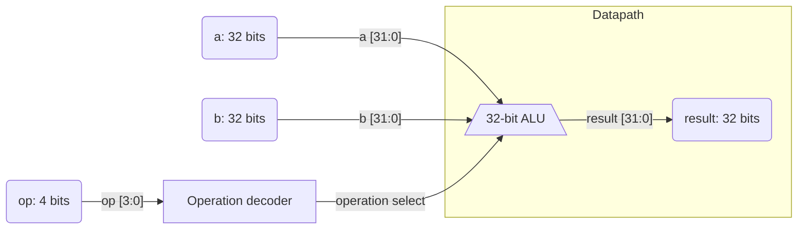

# 32-bit ALU

A 32-bit combinational ALU implemented in Verilog. The result depends directly
on operands `a` and `b` and the operation selector `op`; the design has no
registers or clock.

## Architecture



### Datapath

The ALU block implements addition, subtraction, bitwise operations, one-bit
shifts, and signed comparison. The selected result is available on `result`.

### Control

The `op` field selects the operation. Unlisted operation codes produce zero.

## Interface

| Port | Direction | Width | Description |
|---|---|---:|---|
| `a` | Input | 32 bits | First operand |
| `b` | Input | 32 bits | Second operand |
| `op` | Input | 4 bits | Operation code |
| `result` | Output | 32 bits | Operation result |

The module has no parameters, clock, reset, or internal state. `result` is
declared as `reg` because it is assigned in an `always` block; this does not
imply storage, since the block is combinational.

## Operations

| `op` | Operation | Result |
|---|---|---|
| `0000` | Addition | `a + b` |
| `0001` | Subtraction | `a - b` |
| `0010` | AND | `a & b` |
| `0011` | OR | `a | b` |
| `0100` | XOR | `a ^ b` |
| `0101` | NOT | `~a` |
| `0110` | Shift left | `a << 1` |
| `0111` | Shift right | `a >> 1` |
| `1000` | Signed less than (SLT) | `1` if `$signed(a) < $signed(b)`; otherwise `0` |
| Other | Undefined operation | `0` |


## Files

| File | Description |
|---|---|
| [`alu_v1.v`](./alu_v1.v) | RTL for the combinational `alu_v1` module. |
| [`tb.v`](./tb.v) | Testbench that applies 100 random vectors, prints results, and generates `tb.vcd`. |
| [`synth_v1.ys`](./synth_v1.ys) | Yosys script that reads the RTL, checks the hierarchy, synthesizes `alu_v1`, and writes `alu_v1.blif`. |
| `NangateOpenCellLibrary_typical.lib` | Included standard-cell library. Its contents are intentionally not documented here. The current script does not load it or perform technology mapping with it. |

## Simulation and Synthesis

From this directory, run the simulation with Icarus Verilog:

```sh
iverilog -o tb.vvp alu_v1.v tb.v
vvp tb.vvp
```

The testbench displays the operands, selector, and result using `$monitor`,
and writes the waveform to `tb.vcd`. Inputs are randomized.

First, Yosys performs generic synthesis and generates the BLIF netlist:

```sh
yosys -s synth_v1.ys
```

Next, `yosys-abc` loads the Nangate library, reads the BLIF, optimizes the
logic graph, performs technology mapping, and reports the delay and path:

```text
yosys-abc
read_lib NangateOpenCellLibrary_typical.lib
read_blif alu_v1.blif
strash
map
stime
print_delay
```

Run both steps from this directory. The `.ys` script generates `alu_v1.blif`;
the `.lib` library is loaded separately in ABC and is not modified. No timing
constraints are applied: there is no clock period or input/output delay.
`stime` and `print_delay` report the delay estimated by ABC using the loaded
library, not an analysis against design constraints.

## Reported Synthesis Metrics

Results provided for the ABC run:

| Metric | Value |
|---|---:|
| Wire load | `none` |
| Gates | 601 (20.8 %) |
| Capacitance | 3.6 ff (0.0 %) |
| Area | 596.64 (100.0 %) |
| Delay | 1001.73 ps (16.0 %) |

These figures correspond to the ABC flow described above for the current ALU.
Percentages are transcribed as reported. No timing constraints were applied.

## Critical Path Analysis

Reported path: primary input `b[1]` to primary output `result[31]`. The table
preserves the cells, pins, arrival times, and I/O times from the ABC report.
Times are expressed in picoseconds.

The long chain of combinational cells is consistent with a carry dependency
propagating across multiple bits. The RTL uses signed comparison for SLT.
The cell report alone does not identify whether the path belongs to addition,
subtraction, or SLT: logic may be shared or restructured during synthesis and
mapping. Isolating operations or comparing alternative implementations is
needed to confirm its source.

Future experiments can replace the carry implementation with another adder
architecture and rerun the same ABC flow. For a valid comparison, keep the
same library, mapping commands, and lack of constraints, and compare delay
(`stime`), area, and cell count.

| Level | Cell/pin | Type | I/O times (ps) | Arrival (ps) |
|---:|---|---|---|---:|
| 0 | Primary input `b[1]` | — | — | 0.0 |
| 1 | `n285/A` | `INV_X1` | `0.0 -> 15.2` | 15.2 |
| 2 | `n286/A1` | `NAND2_X1` | `15.2, 0.0 -> 35.3` | 35.3 |
| 3 | `n375/A2` | `NAND2_X1` | `35.3, 35.3 -> 58.0` | 58.0 |
| 4 | `n385/B1` | `AOI21_X1` | `44.1, 58.0, 44.1 -> 88.1` | 88.1 |
| 5 | `n394/B1` | `OAI21_X1` | `22.7, 88.1, 77.9 -> 118.3` | 118.3 |
| 6 | `n406/B1` | `AOI21_X1` | `33.1, 118.3, 57.9 -> 148.4` | 148.4 |
| 7 | `n414/B1` | `OAI21_X1` | `22.7, 148.4, 77.9 -> 178.6` | 178.6 |
| 8 | `n422/B1` | `AOI21_X1` | `44.1, 178.6, 44.1 -> 208.7` | 208.7 |
| 9 | `n430/B1` | `OAI21_X1` | `22.7, 208.7, 77.9 -> 238.9` | 238.9 |
| 10 | `n440/B1` | `AOI21_X1` | `44.1, 238.9, 44.1 -> 269.0` | 269.0 |
| 11 | `n448/B1` | `OAI21_X1` | `22.7, 269.0, 77.9 -> 299.2` | 299.2 |
| 12 | `n458/B1` | `AOI21_X1` | `44.1, 299.2, 44.1 -> 329.2` | 329.2 |
| 13 | `n466/B1` | `OAI21_X1` | `22.7, 329.2, 77.9 -> 359.5` | 359.5 |
| 14 | `n476/B1` | `AOI21_X1` | `44.1, 359.5, 44.1 -> 389.5` | 389.5 |
| 15 | `n484/B1` | `OAI21_X1` | `22.7, 389.5, 77.9 -> 419.8` | 419.8 |
| 16 | `n495/B1` | `AOI21_X1` | `44.1, 419.8, 44.1 -> 449.8` | 449.8 |
| 17 | `n511/C1` | `OAI211_X1` | `22.7, 22.7, 449.8, 77.9 -> 485.1` | 485.1 |
| 18 | `n522/A1` | `NAND3_X1` | `485.1, 68.9, 44.1 -> 510.5` | 510.5 |
| 19 | `n523/A1` | `NAND2_X1` | `510.5, 59.3 -> 530.6` | 530.6 |
| 20 | `n533/B1` | `AOI21_X1` | `44.1, 530.6, 44.1 -> 560.7` | 560.7 |
| 21 | `n552/C1` | `OAI211_X1` | `59.3, 59.3, 560.7, 84.1 -> 595.9` | 595.9 |
| 22 | `n561/A1` | `NAND3_X1` | `595.9, 68.9, 44.1 -> 621.3` | 621.3 |
| 23 | `n573/A1` | `NAND3_X1` | `621.3, 59.3, 22.7 -> 646.7` | 646.7 |
| 24 | `n585/A1` | `NAND3_X1` | `646.7, 68.9, 44.1 -> 672.1` | 672.1 |
| 25 | `n596/A1` | `NAND3_X1` | `672.1, 59.3, 22.7 -> 697.5` | 697.5 |
| 26 | `n607/A1` | `NAND3_X1` | `697.5, 68.9, 44.1 -> 722.9` | 722.9 |
| 27 | `n620/B1` | `AOI21_X1` | `73.1, 722.9, 59.3 -> 753.0` | 753.0 |
| 28 | `n636/B1` | `OAI21_X1` | `68.9, 753.0, 33.1 -> 783.2` | 783.2 |
| 29 | `n648/B1` | `AOI21_X1` | `84.1, 783.2, 59.3 -> 813.2` | 813.2 |
| 30 | `n661/B1` | `OAI21_X1` | `68.9, 813.2, 44.1 -> 843.5` | 843.5 |
| 31 | `n672/B1` | `AOI21_X1` | `28.9, 843.5, 59.3 -> 873.5` | 873.5 |
| 32 | `n687/B1` | `OAI21_X1` | `68.9, 873.5, 33.1 -> 903.8` | 903.8 |
| 33 | `n688/A1` | `AND3_X1` | `903.8, 71.6, 59.3 -> 940.4` | 940.4 |
| 34 | `n690/B1` | `OAI21_X1` | `66.8, 940.4, 933.8 -> 970.6` | 970.6 |
| 35 | `n701/A1` | `NAND2_X1` | `970.6, 961.8 -> 990.7` | 990.7 |
| 36 | Primary output `result[31]` | — | — | — |

At level 36, the report gives a required time of `-1000000000.0 ps` and slack
of `-1000000960.0 ps`. These values are shown exactly as reported by ABC; since
there are no timing constraints, they should not be interpreted as a violation
of a target clock period.