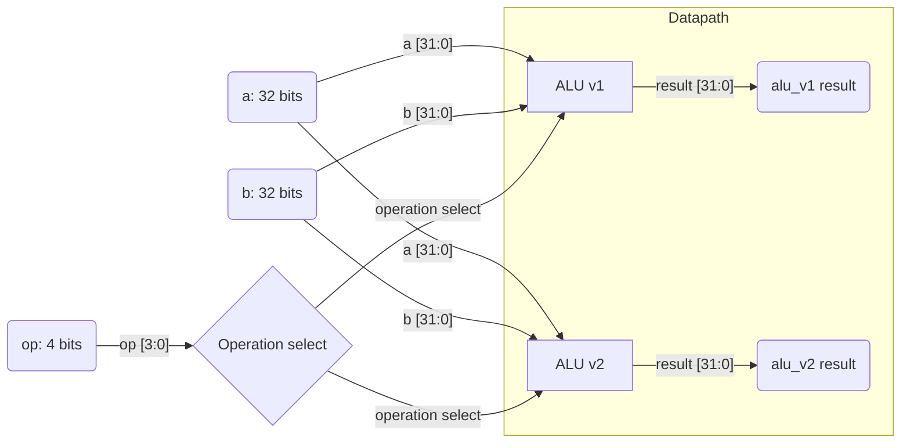
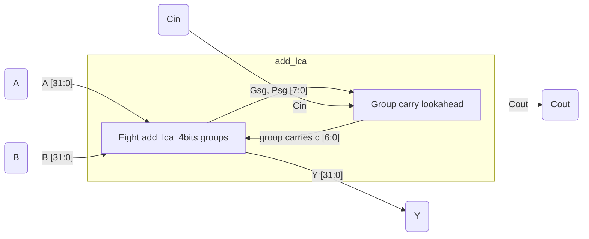

# 32-bit ALU

A 32-bit combinational ALU project with two implementations. `alu_v1` uses
Verilog arithmetic and comparison operators; `alu_v2` uses a grouped
lookahead carry adder (LCA) for addition, subtraction, and signed less-than.
Neither design has registers or a clock.

## Architecture



### Datapath

Both ALU implementations provide addition, subtraction, bitwise operations,
one-bit shifts, and signed comparison.

`alu_v1` expresses addition, subtraction, and signed comparison with Verilog
operators. `alu_v2` instantiates separate `add_lca` blocks for addition and
two's-complement subtraction. Its signed less-than result is derived from the
subtraction result and the signed overflow condition.

The 32-bit LCA is divided into eight 4-bit groups. Each group computes local
generate/propagate terms, and the parent adder computes lookahead carries
between groups.

### Control

The `op` field selects the operation in either ALU. Unlisted operation codes
produce zero.

## Interface

| Port | Direction | Width | Description |
|---|---|---:|---|
| `a` | Input | 32 bits | First operand |
| `b` | Input | 32 bits | Second operand |
| `op` | Input | 4 bits | Operation code |
| `result` | Output | 32 bits | Operation result |

Both top-level modules use the same interface and have no parameters, clock,
reset, or internal state. `result` is declared as `reg` because it is assigned
in an `always` block; this does not imply storage, since the block is
combinational.

## Operations

| `op` | Operation | Result |
|---|---|---|
| `0000` | Addition | `a + b` |
| `0001` | Subtraction | `a - b` |
| `0010` | AND | `a & b` |
| `0011` | OR | `a | b` |
| `0100` | XOR | `a ^ b` |
| `0101` | NOT | `~a` |
| `0110` | Shift left | `a << 1` |
| `0111` | Shift right | `a >> 1` |
| `1000` | Signed less than (SLT) | `1` if `$signed(a) < $signed(b)`; otherwise `0` |
| Other | Undefined operation | `0` |

## Lookahead Carry Adder Architecture



Each four-bit group computes its local sum, group-generate, and
group-propagate signals. The parent module uses the group signals and `Cin`
to calculate carry inputs for the groups and the final `Cout`.

## LCA Modules and Parameters

| Module | Parameter | Default | Description |
|---|---|---:|---|
| `add_lca` | `N` | 32 | Operand width; this implementation is wired for a 32-bit adder made of eight 4-bit groups. |
| `add_lca_4bits` | `N` | 4 | Group width; this implementation is wired for a four-bit slice. |

### `add_lca` Ports

| Port | Direction | Width | Description |
|---|---|---:|---|
| `A`, `B` | Input | `N` bits (32 in this design) | Operands |
| `Cin` | Input | 1 bit | Input carry |
| `Y` | Output | `N` bits (32 in this design) | Sum |
| `Cout` | Output | 1 bit | Final carry |

### `add_lca_4bits` Ports

| Port | Direction | Width | Description |
|---|---|---:|---|
| `A`, `B` | Input | `N` bits (4 in this design) | Group operands |
| `Cin` | Input | 1 bit | Group input carry |
| `Gg` | Output | 1 bit | Group-generate signal |
| `Pg` | Output | 1 bit | Group-propagate signal |
| `Y` | Output | `N` bits (4 in this design) | Group sum |

## Files

| File | Description |
|---|---|
| [`alu_v1.v`](./alu_v1.v) | RTL for the combinational ALU using Verilog arithmetic and comparison operators. |
| [`alu_v2.v`](./alu_v2.v) | RTL for the ALU using the lookahead carry adder. |
| [`add_lca.v`](./add_lca.v) | 32-bit grouped lookahead carry adder. |
| [`add_lca_4bits.v`](./add_lca_4bits.v) | Four-bit lookahead carry group used by `add_lca`. |
| [`tb.v`](./tb.v) | Testbench that drives both ALUs with 100 shared random input vectors and generates `tb.vcd`. |
| [`synth_v1.ys`](./synth_v1.ys) | Yosys script that synthesizes `alu_v1` and writes `alu_v1.blif`. |
| [`synth_v2.ys`](./synth_v2.ys) | Yosys script that synthesizes `alu_v2` and its LCA dependencies and writes `alu_v2.blif`. |
| `NangateOpenCellLibrary_typical.lib` | Included standard-cell library, loaded separately by ABC; the library file is not modified by the flow. |

## Simulation and Synthesis

From this directory, compile and run the testbench with Icarus Verilog:

```sh
iverilog -o tb.vvp alu_v1.v alu_v2.v add_lca.v add_lca_4bits.v tb.v
vvp tb.vvp
```

The testbench applies the same 100 randomized operand and operation vectors to
both ALUs and prints their results with `$monitor`. The waveform is written to
`tb.vcd`. The testbench does not assert that the results match.

Run the matching Yosys script to generate each generic BLIF netlist:

```sh
yosys -s synth_v1.ys
yosys -s synth_v2.ys
```

Then run ABC separately for each implementation, using its corresponding
BLIF file:

```text
yosys-abc
read_lib NangateOpenCellLibrary_typical.lib
read_blif alu_v1.blif
strash
map
stime
print_delay
```

For `alu_v2`, replace `alu_v1.blif` in the ABC command with `alu_v2.blif`.
Run the commands from this directory. ABC loads the `.lib` file separately;
it is not modified by synthesis or mapping. No timing constraints are applied:
there is no clock period or input/output delay. `stime` and `print_delay`
report the delay estimated by ABC using the loaded library, not an analysis
against design constraints.

## Reported Synthesis Metrics

Results provided for both ABC runs:

| Metric | `alu_v1` | `alu_v2` |
|---|---:|---:|
| Wire load | `none` | `none` |
| Gates | 601 (20.8 %) | 729 (19.5 %) |
| Capacitance | 3.6 ff (0.0 %) | 3.6 ff (0.0 %) |
| Area | 596.64 (100.0 %) | 740.81 (100.0 %) |
| Delay | 1001.73 ps (16.0 %) | 562.02 ps (16.6 %) |

`alu_v1` uses Verilog arithmetic operators; `alu_v2` uses the grouped LCA.
The LCA run reports lower delay and higher area and gate count. Percentages are
transcribed as reported. No timing constraints were applied.

## `alu_v1` Critical Path

Reported path: primary input `b[1]` to primary output `result[31]`. The table
preserves the cells, pins, arrival times, and I/O times from the ABC report.
Times are expressed in picoseconds.

The long chain of combinational cells is consistent with a carry dependency
propagating across multiple bits. The RTL uses signed comparison for SLT.
The cell report alone does not identify whether the path belongs to addition,
subtraction, or SLT: logic may be shared or restructured during synthesis and
mapping. Isolating operations or comparing alternative implementations is
needed to confirm its source.

| Level | Cell/pin | Type | I/O times (ps) | Arrival (ps) |
|---:|---|---|---|---:|
| 0 | Primary input `b[1]` | — | — | 0.0 |
| 1 | `n285/A` | `INV_X1` | `0.0 -> 15.2` | 15.2 |
| 2 | `n286/A1` | `NAND2_X1` | `15.2, 0.0 -> 35.3` | 35.3 |
| 3 | `n375/A2` | `NAND2_X1` | `35.3, 35.3 -> 58.0` | 58.0 |
| 4 | `n385/B1` | `AOI21_X1` | `44.1, 58.0, 44.1 -> 88.1` | 88.1 |
| 5 | `n394/B1` | `OAI21_X1` | `22.7, 88.1, 77.9 -> 118.3` | 118.3 |
| 6 | `n406/B1` | `AOI21_X1` | `33.1, 118.3, 57.9 -> 148.4` | 148.4 |
| 7 | `n414/B1` | `OAI21_X1` | `22.7, 148.4, 77.9 -> 178.6` | 178.6 |
| 8 | `n422/B1` | `AOI21_X1` | `44.1, 178.6, 44.1 -> 208.7` | 208.7 |
| 9 | `n430/B1` | `OAI21_X1` | `22.7, 208.7, 77.9 -> 238.9` | 238.9 |
| 10 | `n440/B1` | `AOI21_X1` | `44.1, 238.9, 44.1 -> 269.0` | 269.0 |
| 11 | `n448/B1` | `OAI21_X1` | `22.7, 269.0, 77.9 -> 299.2` | 299.2 |
| 12 | `n458/B1` | `AOI21_X1` | `44.1, 299.2, 44.1 -> 329.2` | 329.2 |
| 13 | `n466/B1` | `OAI21_X1` | `22.7, 329.2, 77.9 -> 359.5` | 359.5 |
| 14 | `n476/B1` | `AOI21_X1` | `44.1, 359.5, 44.1 -> 389.5` | 389.5 |
| 15 | `n484/B1` | `OAI21_X1` | `22.7, 389.5, 77.9 -> 419.8` | 419.8 |
| 16 | `n495/B1` | `AOI21_X1` | `44.1, 419.8, 44.1 -> 449.8` | 449.8 |
| 17 | `n511/C1` | `OAI211_X1` | `22.7, 22.7, 449.8, 77.9 -> 485.1` | 485.1 |
| 18 | `n522/A1` | `NAND3_X1` | `485.1, 68.9, 44.1 -> 510.5` | 510.5 |
| 19 | `n523/A1` | `NAND2_X1` | `510.5, 59.3 -> 530.6` | 530.6 |
| 20 | `n533/B1` | `AOI21_X1` | `44.1, 530.6, 44.1 -> 560.7` | 560.7 |
| 21 | `n552/C1` | `OAI211_X1` | `59.3, 59.3, 560.7, 84.1 -> 595.9` | 595.9 |
| 22 | `n561/A1` | `NAND3_X1` | `595.9, 68.9, 44.1 -> 621.3` | 621.3 |
| 23 | `n573/A1` | `NAND3_X1` | `621.3, 59.3, 22.7 -> 646.7` | 646.7 |
| 24 | `n585/A1` | `NAND3_X1` | `646.7, 68.9, 44.1 -> 672.1` | 672.1 |
| 25 | `n596/A1` | `NAND3_X1` | `672.1, 59.3, 22.7 -> 697.5` | 697.5 |
| 26 | `n607/A1` | `NAND3_X1` | `697.5, 68.9, 44.1 -> 722.9` | 722.9 |
| 27 | `n620/B1` | `AOI21_X1` | `73.1, 722.9, 59.3 -> 753.0` | 753.0 |
| 28 | `n636/B1` | `OAI21_X1` | `68.9, 753.0, 33.1 -> 783.2` | 783.2 |
| 29 | `n648/B1` | `AOI21_X1` | `84.1, 783.2, 59.3 -> 813.2` | 813.2 |
| 30 | `n661/B1` | `OAI21_X1` | `68.9, 813.2, 44.1 -> 843.5` | 843.5 |
| 31 | `n672/B1` | `AOI21_X1` | `28.9, 843.5, 59.3 -> 873.5` | 873.5 |
| 32 | `n687/B1` | `OAI21_X1` | `68.9, 873.5, 33.1 -> 903.8` | 903.8 |
| 33 | `n688/A1` | `AND3_X1` | `903.8, 71.6, 59.3 -> 940.4` | 940.4 |
| 34 | `n690/B1` | `OAI21_X1` | `66.8, 940.4, 933.8 -> 970.6` | 970.6 |
| 35 | `n701/A1` | `NAND2_X1` | `970.6, 961.8 -> 990.7` | 990.7 |
| 36 | Primary output `result[31]` | — | — | — |

At level 36, the report gives a required time of `-1000000000.0 ps` and slack
of `-1000000960.0 ps`. These values are shown exactly as reported by ABC; since
there are no timing constraints, they should not be interpreted as a violation
of a target clock period.

## `alu_v2` Critical Path

The reported critical path is from primary input `a[1]` to primary output
`result[0]`. The ABC report numbers the path from level 0 to level 19; level 2
is not listed. The table preserves the reported cell pins, I/O timing values,
and arrival times in picoseconds.

| Level | Cell/pin | Type | I/O times (ps) | Arrival (ps) |
|---:|---|---|---|---:|
| 0 | Primary input `a[1]` | — | — | 0.0 |
| 1 | `n304/B` | `XNOR2_X1` | `0.0, 0.0 -> 56.4` | 56.4 |
| 3 | `n309/A3` | `NAND4_X1` | `58.8, 56.4, 56.4, 40.0 -> 92.2` | 92.2 |
| 4 | `n321/A2` | `NAND4_X1` | `93.6, 92.2, 75.5, 84.9 -> 126.0` | 126.0 |
| 5 | `n322/A1` | `NAND2_X1` | `126.0, 114.5 -> 146.1` | 146.1 |
| 6 | `n323/A1` | `NAND2_X1` | `146.1, 128.8 -> 166.2` | 166.2 |
| 7 | `n324/B1` | `AOI21_X1` | `148.8, 166.2, 112.9 -> 196.3` | 196.3 |
| 8 | `n325/B1` | `OAI21_X1` | `164.6, 196.3, 124.0 -> 226.5` | 226.5 |
| 9 | `n326/B1` | `AOI21_X1` | `163.5, 226.5, 153.3 -> 256.5` | 256.5 |
| 10 | `n327/B1` | `OAI21_X1` | `183.9, 256.5, 143.2 -> 286.8` | 286.8 |
| 11 | `n328/B1` | `AOI21_X1` | `181.4, 286.8, 178.2 -> 316.8` | 316.8 |
| 12 | `n333/B1` | `OAI21_X1` | `55.2, 316.8, 62.7 -> 347.1` | 347.1 |
| 13 | `n339/B1` | `AOI21_X1` | `40.0, 347.1, 84.1 -> 377.1` | 377.1 |
| 14 | `n343/B1` | `OAI21_X1` | `35.3, 377.1, 66.6 -> 407.4` | 407.4 |
| 15 | `n345/A1` | `NAND2_X1` | `407.4, 71.6 -> 427.5` | 427.5 |
| 16 | `n346/A1` | `NAND3_X1` | `427.5, 0.0, 412.4 -> 452.9` | 452.9 |
| 17 | `n349/A1` | `NAND3_X1` | `452.9, 437.6, 62.8 -> 478.3` | 478.3 |
| 18 | `n354/A1` | `NAND4_X1` | `478.3, 125.7, 152.3, 110.8 -> 508.2` | 508.2 |
| 19 | Primary output `result[0]` | — | — | — |

The `stime` summary reports a delay of `562.02 ps`. The `print_delay` report
gives a required time of `-1000000000.0 ps` and slack of `-1000000512.0 ps`.
These values are reproduced as reported; without timing constraints, the
required time and slack do not represent a target clock-period violation.

## Conclusion

The results show the trade-off of using the lookahead carry adder: the
reported delay decreased from `1001.73 ps` to `562.02 ps`, a reduction of
approximately 44% (nearly half). This improvement required more hardware:
the mapped gate count increased from 601 to 729, and area increased from
`596.64` to `740.81`. Thus, `alu_v2` achieves a substantially shorter
combinational delay at the cost of increased gate count and area.